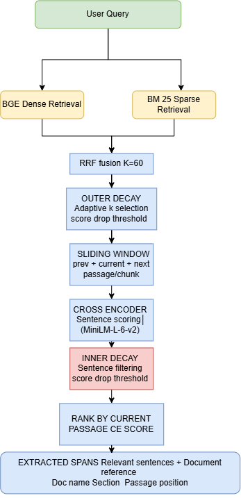

# RegulationQA

**A regulatory document retrieval benchmark spanning Indian, European, and international cybersecurity and data protection frameworks.**

RegulationQA comprises **1,002 questions** over **20 documents**, including cross-document questions that need evidence from two regulatory instruments. It is designed to evaluate retrieval systems under realistic compliance constraints: heterogeneous documents, precise legal terminology, and offline deployment requirements.

> **Paper.** *Adaptive Span Extraction with Hybrid Retrieval for Regulatory Question Answering*, Saurav Chowdhury and Lipika Dey. Accepted at the **ACM India Joint International Conference on Data Science and Management of Data (CODS 2026)**, Main Track, 13–16 December 2026, Gandhinagar, India. To appear in the ACM proceedings (DOI to be added).

> **Reproducing the paper?** Start with the numbered, annotated series in [`code_series/`](code_series/README.md). It covers indexing, retrieval, span extraction, ablations, BERTScore, ObliQA, LLM judges, NLI and corpus analysis, and says which step produces which paper table.

---

## Pipeline Architecture



The retrieval pipeline combines dense (BGE) and sparse (BM25) retrieval via Reciprocal Rank Fusion (k = 60), followed by cross-encoder scoring of the fused candidates (pool m = 20), a ±1 passage sliding window, and sentence-level span extraction. The deployed output is the single best-scoring sentence in the top-ranked candidate's window. A multi-sentence variant that keeps every sentence retained by inner decay (score floor τ, drop tolerance δ) is analysed separately in the paper and is available in `src/pipeline.py`. No generative model is required at inference time.

---

## Dataset

### Format

```csv
id, document_source, question, ground_truth_answer
```

| Field | Description |
|---|---|
| `id` | Unique question identifier |
| `document_source` | Source document name (or `Doc A + Doc B` for cross-document) |
| `question` | Natural language compliance question |
| `ground_truth_answer` | Reference answer extracted from source document |

607 questions are single-source and 395 are cross-document. The raw `document_source` strings contain naming variants of the same instrument; `code_series/adsir_common.py` maps them to one canonical name each.

### Question Types

| Type | Description |
|---|---|
| Definitional | What is X? What does X mean? |
| Obligation | Who must do X? What is required? |
| Procedural | How must X be done? What steps are required? |
| Penalty | What happens if X is violated? |
| Scope | Does X apply to Y? Who is covered? |
| Cross-document | Requires evidence from two instruments |

### Document Corpus (20 documents)

#### Indian Regulatory (14 documents)

| Document | Type | Words |
|---|---|---|
| DPDP Act 2023 | Indian statute | 10,685 |
| Digital Personal Data Protection Rules 2025 | Indian rules | 10,293 |
| CERT-In Directions 2022 | Indian direction | 1,844 |
| IT Act 2000 | Indian statute | 19,525 |
| Electricity Act 2003 | Indian statute | 41,155 |
| NCIIPC Guidelines | Indian guideline | 14,696 |
| RBI Cyber Security Framework | Indian direction | 6,732 |
| e-Governance Policy India | Indian policy | 43,569 |
| SEBI CSCRF | Indian direction | 2,008 |
| State DC Security Guidelines | Indian guideline | 2,657 |
| TRAI Telecom Advisory | Indian direction | 4,057 |
| NCIIPC Rules | Indian rules | 4,044 |
| IT Protected System Rules 2018 | Indian rules | 4,045 |
| Cyber Security Power Sector 2021 | Indian guideline | 8,240 |

#### European (1 document)

| Document | Type | Words |
|---|---|---|
| GDPR (EU) 2016/679 | European statute | 55,799 |

#### International Standards (5 documents)

| Document | Type | Words |
|---|---|---|
| ISO/IEC 27001:2022 † | International standard | 7,194 |
| NIST SP 800-66r2 | International standard | 42,128 |
| NIST Cybersecurity Framework | International standard | 7,834 |
| OECD Digital Security Guidelines | International standard | 4,154 |
| PCI Security Standards † | International standard | 1,107 |

† Proprietary standard. Its full text is **not distributed** in this repository; see [Documents you must obtain yourself](#documents-you-must-obtain-yourself).

---

## Evaluation Results

### RegulationQA, span level (full pipeline)

| Span mode | Token F1 | Uses reference answer? |
|---|---|---|
| Top-1 | 0.2994 | No |
| Query-guided (highest cross-encoder sentence among top-3) | 0.3083 | No |
| Oracle best-of-3 | 0.3737 | **Yes** (upper bound, not a deployable system) |

BERTScore (roberta-large, raw F1): 0.8804 (top-1), 0.8801 (query-guided), 0.8939 (best-of-3). Top-1 spans average 54 words, against about 500 words for a full retrieved chunk.
Step 05 of the code series also reports length-matched controls, because BERTScore can reward length.

### RegulationQA, baselines and LLM judges (oracle best-of-3 spans)

| System | Token F1 | BERT-F1 | Qwen3-4B | Mistral-7B |
|---|---|---|---|---|
| BGE only | 0.2229 | 0.8613 | 46.2% | 79.3% |
| BM25 only | 0.2156 | 0.8590 | 39.5% | 77.1% |
| **Full pipeline (oracle best-of-3)** | **0.3737** | **0.8939** | **82.8%** | **91.4%** |

The judges score the oracle best-of-3 span (chosen using the reference answer), so these percentages measure whether the answer is present in the top-3, not top-1 accuracy. Judge percentages are "correct or partially correct".
Inter-model agreement between Qwen3-4B and Mistral-7B: Cohen's κ = 0.296 (Fair). The gap between token F1 (0.37) and LLM-judged correctness (82.8–91.4%) reflects the limits of overlap metrics on regulatory text, where the same obligation can be phrased in many valid ways.

### Adaptive multi-sentence selection (re-implementation)

Keeping every sentence retained by inner decay (τ = 0, δ = 2.0) instead of only the best one:

| Mode | Words (mean) | Token F1 | BERT-F1 | Qwen3-4B | Mistral-7B |
|---|---|---|---|---|---|
| Adaptive top-1 | 126 | 0.2527 | 0.8702 | 75.9% | 90.6% |
| Adaptive query-guided | 261 | 0.2219 | 0.8640 | 70.1% | 80.3% |

Adaptive selection lowers Token F1 and BERTScore relative to the single best sentence (paired bootstrap differences −0.043 for top-1 and −0.076 for query-guided on the re-implementation), so the single best sentence remains the output. These rows come from a re-implementation of the pipeline, not from the saved run; see the reproducibility notes below.

### ObliQA (Passage-Level, 2,786 test questions)

| System | R@1 | R@5 | R@10 | MAP@10 |
|---|---|---|---|---|
| BGE only | 0.4986 | 0.7146 | 0.7796 | 0.5402 |
| BM25 only | 0.5693 | 0.7548 | 0.8055 | 0.5814 |
| BGE + CE | 0.5725 | 0.7674 | 0.8216 | 0.5967 |
| **Full pipeline (pool m = 20)** | **0.5826** | **0.7904** | **0.8460** | **0.6083** |

Recomputed on all 2,786 test questions with the released code. With a pool of m = 50 the full pipeline reaches R@10 0.8403 and MAP@10 0.6019. `code_series/07_obliqa_results_ablation` gives paired-bootstrap 95% confidence intervals and the m = 20 / 50 / 100 variants.
Published baselines on ObliQA: BM25 (R@10 0.7611, MAP@10 0.6236; Gokhan et al.) and BGE-5shot (R@10 0.7796, MAP@10 0.6178; Li et al.). Our MAP@10 remains below the published BM25 figure.

### Reproducibility notes

* The released spans in `evaluation/extraction_results.csv` come from the original submitted run. Re-running the released code reproduces about 88% of the saved top-1 spans exactly; the rest differ because of small retrieval-pool differences.
* The saved spans are single sentences (the best-scoring sentence of the ±1 window of each candidate). `src/pipeline.py` returns all sentences kept by inner decay; `code_series/03_rqa_span_extraction` computes both and labels them. The adaptive study is `code_series/12_span_extraction_study.py` (with judges in `13_judge_adaptive_spans.py`).
* Hallucination (NLI) numbers in the paper come from the original run; `code_series/09_hallucination_nli` is a fresh re-run and will differ.

---

## Repository Structure

```
RegulationQA/
├── README.md
├── requirements.txt
├── architecture.png              <- pipeline diagram
│
├── code_series/                  <- numbered, annotated pipeline (start here)
│   ├── README.md
│   ├── adsir_common.py           <- shared settings and helpers
│   ├── 01_build_indexes.py ... 11_corpus_analysis.py
│   └── notebooks/                <- the same steps as .ipynb
│
├── dataset/
│   └── regulationqa_v1.csv       <- 1002 Q&A pairs
│
├── documents/
│   └── cleaned_texts/
│       └── *.txt                 <- cleaned text files (18 of 20; ISO/IEC 27001 and PCI texts not included)
│
├── index/
│   ├── faiss_index.bin           <- BGE FAISS index (766 chunks)
│   ├── chunks.pkl                <- chunked passages with metadata
│   └── bm25.pkl                  <- BM25Okapi sparse index
│
├── evaluation/
│   ├── extraction_log.json       <- retrieval results per question
│   ├── extraction_results.csv    <- summary CSV (saved submitted run)
│   ├── qwen_eval.csv             <- Qwen3-4B judge scores
│   ├── combined_eval.csv         <- all evaluation scores
│   ├── overlap_analysis.csv      <- document overlap analysis
│   ├── ablation_results.json     <- ablation study results
│   ├── all_llm_eval.json         <- full LLM evaluation
│   └── baseline_llm_eval.json    <- baseline LLM evaluation
│
├── visualisations/
│   ├── doc_similarity_graph.html <- document similarity graph
│   ├── kg_answers_v2.html        <- retrieval quality graph
│   └── doc_similarity_matrix.csv <- pairwise similarity matrix
│
├── Notebooks/                    <- original working notebooks (kept for history)
│
└── src/
    ├── pipeline.py               <- retrieval pipeline
    ├── evaluate.py               <- evaluation functions
    └── utils.py                  <- helper utilities
```

---

## Quick Start

### Installation

```bash
git clone https://github.com/sauraviitj/RegulationQA_dataset
cd RegulationQA_dataset
pip install -r requirements.txt
```

### Load the Dataset

```python
import pandas as pd

df = pd.read_csv('dataset/regulationqa_v1.csv')
print(f"Questions: {len(df)}")
print(df.head())
```

### Load the Index

```python
import pickle
import faiss

with open('index/chunks.pkl', 'rb') as f:
    chunks = pickle.load(f)
index = faiss.read_index('index/faiss_index.bin')
with open('index/bm25.pkl', 'rb') as f:
    bm25 = pickle.load(f)

print(f"Chunks: {len(chunks)}, Index vectors: {index.ntotal}")
```

### Run the Pipeline

```python
from src.pipeline import RegulationQAPipeline

pipeline = RegulationQAPipeline(index_dir='index/')

query   = "What are the obligations of a Data Fiduciary under DPDP Act?"
results = pipeline.retrieve(query)

for r in results[:3]:
    print(f"\nDocument: {r['doc_name']}")
    print(f"CE Score: {r['top_ce_score']:.3f}")
    for span in r['extracted_spans'][:2]:
        print(f"  -> {span}")
```

### Evaluate

```python
from src.evaluate import evaluate_regulationqa, print_report

metrics = evaluate_regulationqa(df=df, retrieve_fn=pipeline.retrieve)
print_report(metrics, "RegulationQA Results")
```

### Reproduce the paper tables

Follow [`code_series/README.md`](code_series/README.md): run steps 01 to 11 in order (GPU T4 for steps 02, 05, 06, 08, 09, 11).

### Build Index From Scratch

```python
from src.utils import (
    load_documents, chunk_documents,
    build_faiss_index, build_bm25_index, save_index
)

documents  = load_documents('documents/cleaned_texts/')
chunks     = chunk_documents(documents, chunk_size=500, overlap=100)

index, embeddings, model = build_faiss_index(chunks)
bm25                     = build_bm25_index(chunks)

save_index(index, chunks, bm25, output_dir='index/')
```

For reproducing the paper, use the shipped index in `index/`; a rebuilt index can differ slightly.

---

## Requirements

```
sentence-transformers>=2.2.0
faiss-cpu>=1.7.0
rank-bm25>=0.2.2
nltk>=3.7
pymupdf>=1.23.0
python-docx>=0.8.11
scikit-learn>=1.0.0
pandas>=1.5.0
numpy>=1.23.0
tqdm>=4.64.0
transformers>=4.35.0
torch>=2.0.0
```

Code-series steps 05 and 08 additionally use `bert-score`, `accelerate` and `bitsandbytes` (installed by the first cell of each notebook).

---

## License

### Dataset License

Questions and annotations in `dataset/regulationqa_v1.csv` are released under **Creative Commons Attribution 4.0 International (CC BY 4.0)**.

You are free to share and adapt the material for any purpose, provided appropriate credit is given.

### Document License

The cleaned document texts in `documents/cleaned_texts/` are sourced from publicly available government publications and international bodies. Government and EU texts are reusable with attribution; check each source's current terms:

| Document | Source | License |
|---|---|---|
| DPDP Act 2023 | Government of India | Reuse with attribution |
| CERT-In Directions 2022 | MeitY, Government of India | Reuse with attribution |
| IT Act 2000 | Government of India | Reuse with attribution |
| Electricity Act 2003 | Government of India | Reuse with attribution |
| NCIIPC Guidelines | Government of India | Reuse with attribution |
| RBI Cyber Security Framework | Reserve Bank of India | Reuse with attribution |
| e-Governance Policy India | Government of India | Reuse with attribution |
| SEBI CSCRF | SEBI | Reuse with attribution |
| State DC Security Guidelines | Government of India | Reuse with attribution |
| TRAI Telecom Advisory | TRAI | Reuse with attribution |
| NCIIPC Rules | Government of India | Reuse with attribution |
| IT Protected System Rules 2018 | Government of India | Reuse with attribution |
| Cyber Security Power Sector 2021 | Government of India | Reuse with attribution |
| GDPR (EU) 2016/679 | European Union | Reuse with attribution |
| NIST SP 800-66r2 | NIST (US Government) | Public domain |
| NIST Cybersecurity Framework | NIST (US Government) | Public domain |
| OECD Digital Security Guidelines | OECD | Reuse subject to OECD terms |
| ISO/IEC 27001:2022 | ISO/IEC | Proprietary; text not distributed |
| PCI Security Standards | PCI SSC | Proprietary; text not distributed |
| DPDP Rules 2025 | Government of India | Reuse with attribution |

### Documents you must obtain yourself

Two of the 20 documents are proprietary standards. Their full texts are **not distributed** as files in this repository:

- ISO/IEC 27001:2022 (ISO/IEC)
- PCI Security Standards (PCI SSC)

To rebuild the corpus or the index from scratch, obtain these documents from their publishers under their licence terms, extract the text, and save it as `documents/cleaned_texts/ISO_IEC_27001_2022.txt` and `documents/cleaned_texts/PCI_Security_Standards.txt`. Questions that refer to these documents remain in the dataset.

For reproducibility, the shipped index in `index/` contains chunked passages derived from all 20 documents, including these two. Please do not extract or redistribute those passages. If you are a rights holder and want them removed, open a GitHub issue.

### Code License

Source code in `src/` and `code_series/` is released under the **MIT License**.

```
MIT License

Permission is hereby granted, free of charge, to any person obtaining a copy
of this software and associated documentation files (the "Software"), to deal
in the Software without restriction, including without limitation the rights
to use, copy, modify, merge, publish, distribute, sublicense, and/or sell
copies of the Software, and to permit persons to whom the Software is
furnished to do so, subject to the following conditions:

The above copyright notice and this permission notice shall be included in all
copies or substantial portions of the Software.

THE SOFTWARE IS PROVIDED "AS IS", WITHOUT WARRANTY OF ANY KIND, EXPRESS OR
IMPLIED, INCLUDING BUT NOT LIMITED TO THE WARRANTIES OF MERCHANTABILITY,
FITNESS FOR A PARTICULAR PURPOSE AND NONINFRINGEMENT. IN NO EVENT SHALL THE
AUTHORS OR COPYRIGHT HOLDERS BE LIABLE FOR ANY CLAIM, DAMAGES OR OTHER
LIABILITY, WHETHER IN AN ACTION OF CONTRACT, TORT OR OTHERWISE, ARISING FROM,
OUT OF OR IN CONNECTION WITH THE SOFTWARE OR THE USE OR OTHER DEALINGS IN THE
SOFTWARE.
```

---

## Citation

If you use RegulationQA or this code, please cite:

to be updated

---

## Acknowledgements

Documents sourced from publicly available government publications of India, the European Union, and international bodies. We thank the annotators who contributed to the human evaluation.

---

## Contact

For questions about the dataset or pipeline, please open a GitHub issue.
